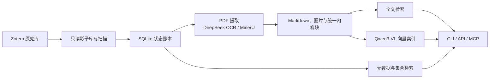

# ZoteroRAG

ZoteroRAG 是一个面向个人文献库的本地优先检索系统。它读取 Zotero 的文献与附件信息，在独立的运行时目录中完成 PDF 提取、内容标准化、向量化和检索，为人工精读、写作和本地 agent 提供稳定的检索入口。

项目的重点是让已有的 Zotero 工作流继续承担文献管理、阅读和 Word 引用。ZoteroRAG 负责构建可恢复、可检查、可增量更新的检索数据层，并保留文献、父条目、附件、解析产物和检索结果之间的身份信息。

## 能做什么

- 从 Zotero 数据库和附件目录建立只读影子库，并同步条目、集合、父条目和附件关系。
- 以 DeepSeek OCR 作为默认 PDF 提取服务，同时保留 MinerU 作为可切换的提取后端。
- 将 OCR 结果统一整理为 Markdown、图片资源、文本块和图片块，供后续全文检索与向量检索共同使用。
- 使用 `qwen3-vl-embedding` 作为默认向量模型，覆盖文本向量和多模态向量。图片块会结合图片标题以及前后文生成检索表示。
- 支持增量建库、分段 OCR、断点恢复、缓存复用、失败重试、人工纳入或排除以及向量重建。
- 同时提供元数据搜索、全文搜索、文本向量搜索和多模态搜索。
- 通过命令行、FastAPI 和 MCP stdio 暴露本地能力，便于脚本、编辑器和 agent 使用。
- 用 SQLite 状态账本记录任务、检查点、解析产物、文本块、嵌入批次和向量索引状态。

## 数据流



运行时数据和原始 Zotero 库分开保存。ZoteroRAG 的解析 Markdown 与图片适合定位检索依据，原始 PDF 仍应通过 Zotero 进行最终阅读和上下文核对。

## 设计原则

### Zotero 是文献管理来源

ZoteroRAG 复制并读取 Zotero 的数据库和附件信息，建立自己的状态账本和索引。它不会把运行时状态写回 Zotero，也不会替代 Zotero 的阅读、整理和引用功能。

自动捕获的题名、作者、期刊、卷期、页码和附件关系可能存在遗漏或少量错误。检索结果保留父条目与当前附件的身份信息，最终书目信息仍可结合 Zotero 和 Crossref 检查。

### 本地保存中间产物

OCR 请求和嵌入请求可以使用外部 API，但任务状态、缓存、标准化产物、检查点和向量索引保存在本地。长任务可以暂停、恢复或从已完成的阶段继续执行。

### 解析后再检索

不同 OCR 服务的返回格式会在进入后续流程前统一为项目内部的文档、图片和内容块结构。下游标准化、分块、嵌入和检索不需要依赖某一个 OCR 服务的原始响应格式。

### 搜索结果服务于精读

向量检索和全文检索用于快速找到可能相关的文献和片段。结果中会保留文档、父条目、附件、内容块和解析产物的关联信息，方便在报告中链接检索依据。论文的期刊页码、PDF 内部页码和封面页之间可能存在差异，检索结果适合作为定位辅助，原文结论仍需要回到 PDF 阅读上下文。

## 默认组件

| 能力 | 默认实现 | 备用或可切换实现 |
| --- | --- | --- |
| 文献来源 | Zotero 只读影子库 | — |
| 状态存储 | SQLite | — |
| OCR / PDF 提取 | DeepSeek OCR | MinerU |
| 文本与多模态嵌入 | `qwen3-vl-embedding` | 可配置其他 profile 或测试 stub |
| 向量索引 | LanceDB | SQLite 本地向量后端 |
| 服务入口 | CLI、FastAPI、MCP stdio | Python API |

## 快速开始

### 1. 安装

项目需要 Python 3.11 或更高版本。安装完整本地能力可以执行：

```powershell
pip install -e ".[api,mcp,providers,pdf,lancedb]"
```

开发环境可以额外安装测试依赖：

```powershell
pip install -e ".[api,mcp,providers,pdf,lancedb,dev]"
```

### 2. 创建配置

```powershell
Copy-Item config/config.example.toml config/config.toml
New-Item -ItemType File .env
```

根据本机环境修改 `config/config.toml` 中的 Zotero 路径、运行时目录、OCR、并发和嵌入 profile。默认 OCR provider 是 DeepSeek，默认文本和多模态向量 profile 使用 `qwen3-vl-embedding`。

在 `.env` 中填写服务密钥。示例：

```dotenv
DEEPSEEK_KEY=your_deepseek_key
BAILIAN_KEY=your_bailian_key
MINERU_KEY=your_mineru_key
```

`MINERU_KEY` 支持用逗号分隔多个 key，以便轮换和冷却。嵌入服务使用 `BAILIAN_KEY`、`DASHSCOPE_API_KEY` 或 `DASHSCOPE_KEY` 中可用的配置。不要把真实密钥提交到版本库。

### 3. 初始化并扫描 Zotero

```powershell
zoterorag init-state
zoterorag providers status
zoterorag scan
```

`scan` 会刷新 Zotero 影子库，识别新增或变更的附件，并将元数据和集合关系写入本地状态账本。首次使用前应先检查扫描结果，再开始耗时的提取和嵌入任务。

### 4. 增量建库

先生成计划：

```powershell
zoterorag ingest start --mode incremental
```

确认计划后执行：

```powershell
zoterorag ingest start --mode incremental --execute
```

建库流水线会依次处理 PDF 提取、内容标准化和嵌入。任务可以使用 `Ctrl+C` 中断，之后通过任务 ID 恢复：

```powershell
zoterorag jobs list --kind ingest
zoterorag ingest resume <JOB_ID> --execute
```

同一时间运行的 ingest 和 reembed 任务会使用状态目录中的 runner lock，避免多个进程同时写入同一批状态或向量数据。

## 检索示例

元数据检索不需要调用嵌入服务：

```powershell
zoterorag search-metadata "transformer attention"
zoterorag search-metadata "CRISPR" --classification included_auto
```

全文检索针对标准化后的文本块和图片块：

```powershell
zoterorag search-fulltext "pollen tube guidance"
zoterorag search-fulltext "figure 3" --chunk-type image
```

文本向量检索使用默认文本 profile：

```powershell
zoterorag search-vector "defensin LURE pollen" --mode text
```

多模态检索使用图片或图文查询：

```powershell
zoterorag search-vector "similar figures to this" --mode multimodal
```

在指定 Zotero 集合内检索：

```powershell
zoterorag search-by-collection <COLLECTION_KEY> --query "glutaraldehyde"
```

更适合 agent 使用的查询约定位于 [skills/zoterorag-query.md](skills/zoterorag-query.md)。它要求将检索结果与报告一并输出，并在报告中保留结果链接，便于复核检索依据。

## 服务与 agent 接入

启动本地 HTTP 服务：

```powershell
zoterorag serve
```

默认监听 `127.0.0.1:8765`。服务提供健康检查、状态和诊断、扫描、建库任务控制、文档与集合查询、全文检索、向量检索、模型 profile 管理以及备份恢复相关接口。

启动 MCP stdio 服务：

```powershell
zoterorag mcp
```

MCP 入口适合由本地 agent 直接调用。agent 可以先通过元数据或集合检索缩小范围，再使用全文和向量检索定位内容，最后把检索条目、内容块和解析产物链接写入报告。

## 运行时目录

典型目录结构如下：

```text
data/
├── state/
│   ├── state.sqlite              # 任务、文档、内容块和索引状态
│   └── ingest_runner.lock        # 长任务互斥锁
├── shadow/
│   └── zotero.sqlite             # Zotero 数据库的运行时影子副本
├── extract_cache/                # OCR / PDF 提取缓存
├── normalized/                   # 标准化 Markdown 和图片资源
├── embedding_cache/              # 可选的嵌入响应缓存
└── vector_store/                 # 本地向量后端数据
```

运行时目录应放在有足够磁盘空间的位置，并纳入本机备份策略。原始 Zotero 数据库和附件目录由 Zotero 管理，ZoteroRAG 的状态库和解析产物可以单独备份与恢复。

## 项目结构

```text
src/zoterorag/
├── cli.py                 # 命令行入口
├── api/                   # FastAPI 服务
├── mcp/                   # MCP stdio 服务
├── extraction/            # DeepSeek / MinerU 提取和任务恢复
├── normalization/         # Markdown、图片和内容块标准化
├── embeddings/            # Qwen3-VL 嵌入和索引
├── search/                # 元数据、全文和向量检索
├── storage/               # SQLite 状态账本与运行时数据
└── documents.py           # Zotero 文档与附件关系
```

## 开发与验证

安装开发依赖后，可以运行：

```powershell
python -m pytest -q
ruff check src tests
```

不希望调用外部服务时，可以在测试或演练命令中显式使用 stub provider。生产建库应使用配置文件中的真实 OCR 和嵌入 provider，并通过 `zoterorag providers status` 检查密钥和端点状态。

## 当前边界

- ZoteroRAG 面向本地个人文献库，运行时状态和索引按本地目录组织。
- 原始 PDF 是最终阅读依据，解析 Markdown 和图片主要承担检索、定位和报告引用辅助功能。
- OCR 和嵌入服务的质量、限流和费用取决于所配置的外部 provider。
- 自动捕获的 Zotero 元数据需要结合 Zotero 原始条目和 Crossref 做最终核验。
- 页码只作为可选的定位信息处理，不能替代文献身份、上下文阅读或期刊书目信息核验。

